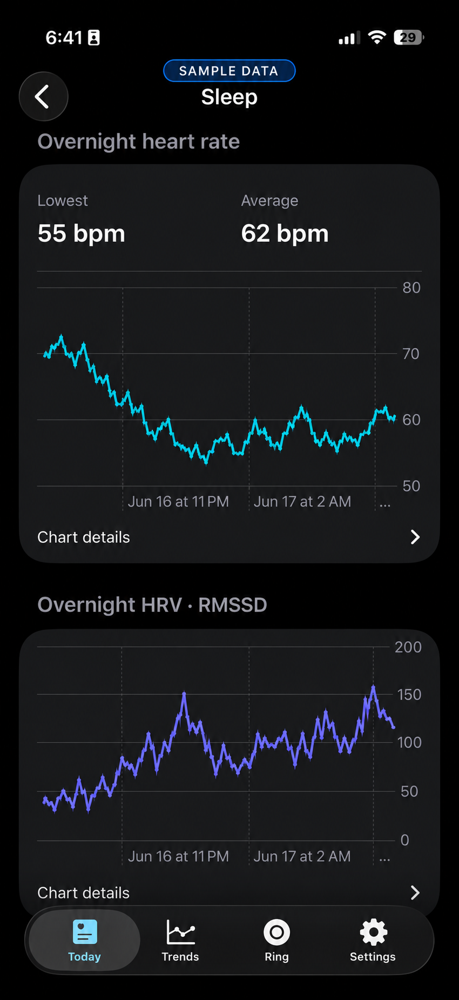
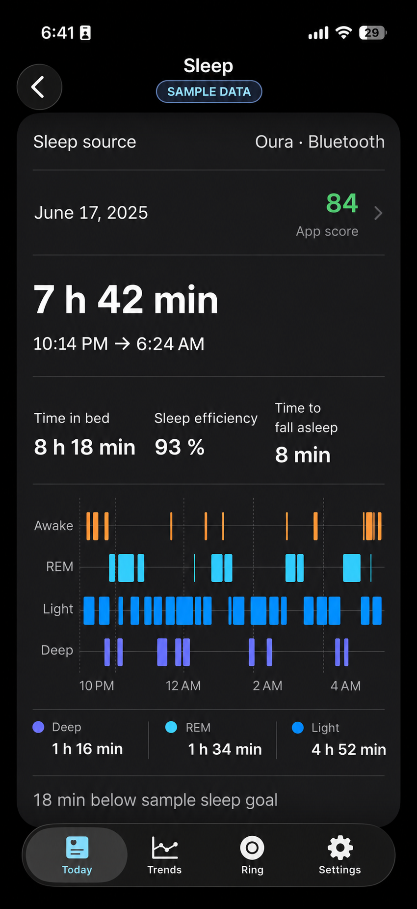

# Youra

Your ring. Your watch. Your data.

An independent, local-first iPhone dashboard for Oura ring records and read-only
Apple Health data. Built with SwiftUI, Swift Charts and Rust. No required app backend,
Oura API subscription, proprietary model download or bundled health database.

## Features

- A local morning brief, inspectable habit/workout/schedule comparisons, and timestamp-aware overnight heart-rate summaries. Missing data stays unknown; comparisons are associations, not causal or medical claims.
- Private English voice check-ins, with typed fallback and editable confirmation before saving. Microphone audio is never uploaded or retained.
- Optional spoken conversations with your own HTTPS Hermes server. Preview each message and selected context before Send; no shared hosted AI service. [Setup and privacy](docs/public/HERMES.md).
- Optional daily Oura-only iMessage sleep brief through your own Hermes + Photon setup, scheduled from the ring’s recorded wake time. It stays off until explicitly enabled; late or incomplete syncs are skipped. [Setup and privacy](docs/public/HERMES.md).
- Battery and supported ring history over Bluetooth with your own key.
- Oura and Apple Watch measurements without double-counting activity or mixing HRV methods.
- Actual sleep stages, sleep/wake times, deep/REM/core durations, recorded awakenings and overnight physiology when available.
- Direct Bluetooth Oura sleep by default, with no silent Apple Health fallback. Today and Sleep name the actual source; Apple Watch sleep and automatic fallback are explicit Settings choices.
- Time in bed, sleep efficiency and time to fall asleep, plus longest recorded sleep stretch, sleep-window midpoint and seven-night bedtime consistency. Calculations use recorded intervals—not guessed sleep stages.
- Fahrenheit skin-temperature readouts and temperature differences; original Celsius records stay intact.
- Local Oura account export import for historical scores, contributors, sessions, stress/resilience and other dated fields.
- Live Sleep and Activity goal scores with editable targets and transparent breakdowns; custom Recovery uses comparable personal baselines. All are independent experimental formulas, not Oura algorithms or clinical assessments.
- Dated history and live trends. Historical imports remain separate from live scores and charts.
- A sleep-first native Today screen that opens separate Sleep, Activity and Recovery reports. Sleep includes timing, stage durations/shares, awakenings, a touch-to-inspect timeline, overnight HR/HRV and a seven-day comparison. Activity and Recovery have their own focused charts. HRV methods/device identities are not joined; display signals are bounded without removing originals.
- Color-banded app-score readouts, a native loading screen, and a top-right ring battery/connection indicator. Opening the app downloads ring history and refreshes battery through the saved pairing; short foreground transitions are coalesced. Saved data remains accessible during sync or a connection failure.

## Build

Use [the public build guide](docs/public/BUILD.md). Patched Bluetooth dependencies
ship here with their licenses. Configure your own bundle ID and Apple signing
team in a gitignored local file. Requires iOS 17+, Xcode and suitable provisioning.

Do not reset or re-pair an existing ring just to update this app.

Opening the app automatically downloads ring history when a compatible ring and
saved pairing key are configured. Keep the ring nearby and Bluetooth enabled.
The loading screen shows real progress, with retry and saved-data recovery.
**Ring → Sync ring** remains available manually. Sleep belongs to the wake-up date:
a night beginning October 8 and ending October 9 appears under October 9.
See [sleep insights and formulas](docs/public/SLEEP.md).

## Preview

These edited examples use synthetic dates, measurements, and chart traces. They
are illustrative, not live data or records from anyone's account.

## Compatibility

Gen 3 Horizon authentication/sync has been confirmed on one physical ring in this
fork. Ring 4 uses the shared protocol but is untested here; Ring 5 has upstream
evidence but is also untested in this fork. Legacy/unknown rings can use import
and available Apple Health records without a live connection. This is not a claim
of universal ring support. See [the matrix](docs/public/COMPATIBILITY.md).

BLE cannot restore history erased by a reset. Official Oura scores remain imported
historical results. Live app scores are explicitly our own goal-based formulas,
not official equivalents. Direct-ring steps/energy currently use activity-intensity
estimates and are labeled accordingly. Missing data stays unavailable. Recorded
awakenings are not clinical EEG arousals.
This is experimental software, not a medical device.

## Privacy and release

Health records and confirmed check-ins stay on the iPhone by default; keys use device-only Keychain storage. Manual Hermes chats send only reviewed text and selected summaries. If a user enables the optional daily message, direct Oura sleep facts go over the user’s private tailnet to their Mac and the selected Hermes model; cloud model providers may retain data or charge, while a local model keeps inference on-device to that Mac. Device
backups, manual exports and diagnostics may still contain sensitive data. Read
[the release checklist](docs/public/RELEASING.md) and use the curated source
packager before uploading anything. Never post pairing keys, health exports,
database files, local signing configuration or identifiable diagnostics in issues.

Based on [Open Health](https://github.com/Th0rgal/open_health) and
[Open Oura](https://github.com/Th0rgal/open_oura). Cracked-Oura is a visual/workflow
reference, not copied frontend code or a bundled dependency.
[Third-party notices](THIRD_PARTY_NOTICES.md) · [MIT license](LICENSE).

The public repository is [ytolba/Youra-Health](https://github.com/ytolba/Youra-Health).
App identity is now Youra; upgrading does not require a reset, re-pairing, or a new bundle ID.
Youra is independent and is not affiliated with Oura or Apple.
